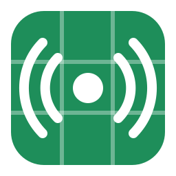

<p align="center">
  
</p>

<h1 align="center">SheetStation</h1>

> [!WARNING]
> **SheetStation is not secure. Do not use it for sensitive or private files.**
> There are no accounts, passwords or access controls. Anyone who has your Apps Script URL can
> see your devices and the names of your shared files, and can download anything in a shared
> folder from a device that is online. Devices do not verify each other's identity. Only share
> files you would be comfortable making public, such as e-books.

Share files (e-books and the like) **directly between your devices** over WebRTC, with a
**Google Sheet as the only server**. The sheet is just a notice board: devices post who
they are, what they share, and a one-time connection offer/answer. The files themselves go
straight from one device to the other.

Runs on **Windows, Linux, Android and Sailfish OS** (same C++ core, Qt UI; Silica UI on Sailfish).

```
 Device A                    Google Sheet (Apps Script)                   Device B
 ───────                     ──────────────────────────                   ───────
 hello {name, files}  ───▶   Peers tab   ◀───  hello {name, files}
 "Get book.epub"
 offer (SDP)          ───▶   Mailbox tab  ───▶ poll → answer (SDP)
 poll ◀───────────────────── Mailbox tab ◀───
 ◀════════════════ WebRTC data channel (direct, DTLS) ═════════════════▶ book.epub
```

## 1. Set up the sheet (once)

1. Create a new Google Sheet.
2. **Extensions → Apps Script**, replace the editor's contents with [`appscript/Code.gs`](appscript/Code.gs), save.
3. **Deploy → New deployment →** type **Web app**
   - Execute as: **Me**
   - Who has access: **Anyone**
4. Authorize, then copy the **Web app URL** (ends in `/exec`).

The script creates its `Peers` and `Mailbox` tabs on first use. Anyone with the URL can use
your board. That's fine for non-sensitive files, but don't post the URL publicly.

## 2. Use the app

On every device: open SheetStation → **Settings**, paste the same `/exec` URL, save.

- Put files in the **shared folder** (default `Documents/SheetStation/Shared`).
- Other online devices and their files appear under **Devices**; tap **Get**.
- Received files land in the **download folder** (default `Downloads/SheetStation`),
  verified with SHA-256.

### Connectivity

By default the app uses Google's free public STUN server (`stun.l.google.com:19302`). It only
tells each device its own public address so devices on different home networks can connect;
no file data goes through it. Clear the STUN field in Settings to connect only over the same
network or IPv6. Strict networks (some campus/corporate Wi-Fi, mobile carrier NAT) may still
block direct links; a relay mode is a planned next step.

## Building

```sh
git clone --recursive https://github.com/IsaakRichards/SheetStation
```

Requires CMake ≥ 3.16 (3.13 for Sailfish), a C++17 compiler and OpenSSL. libdatachannel
(v0.24.6) is a submodule and builds statically with media and WebSocket support turned off.

| Platform | Qt | Build |
|---|---|---|
| Linux | Qt 6 (`qt6-base-dev qt6-declarative-dev` + QML Controls modules) | `cmake -B build -G Ninja && cmake --build build` |
| Windows | Qt 6 MSVC + OpenSSL 3 | same; `windeployqt --qmldir qml/generic`, copy the OpenSSL DLLs |
| Android | Qt 6.5+ for Android, NDK r26 | `git clone https://github.com/KDAB/android_openssl third_party/android_openssl`, then `qt-cmake … && cmake --build build --target apk` |
| Sailfish OS | Qt 5.6 + Silica (Sailfish SDK) | `sfdk build` (uses `rpm/sheetstation.spec`, `-DSHEETSTATION_SAILFISH=ON`) |

GitHub Actions (`.github/workflows/build.yml`) builds Linux, Windows and Android, runs the
core self-test, and uploads a tarball, a Windows folder and a sideloadable APK as artifacts.
Sailfish is built locally with the Sailfish SDK.

Core-only build plus self-test (no Qt needed):

```sh
cmake -B build -DSHEETSTATION_APP=OFF -DSHEETSTATION_TESTS=ON && cmake --build build && ./build/sheetstation_core_test
```

## Layout

```
appscript/Code.gs        signaling backend (Apps Script bound to the sheet)
src/core/                portable C++17: WebRTC link + file protocol (libdatachannel), no Qt
src/app/                 Qt glue: sheet client, Station object exposed to QML
qml/generic/             Qt Quick Controls 2 UI (Windows / Linux / Android)
qml/sailfish/            Silica UI (Sailfish OS)
android/, rpm/, packaging/   platform packaging
tests/core_test.cpp      two in-process peers transferring files over real WebRTC
```

## Protocol notes

- Signaling is non-trickle: each side waits for ICE gathering to finish and posts one
  complete SDP, so a connection costs one offer row and one answer row.
- If two devices dial each other at the same moment, the one with the smaller device id
  keeps its offer and the other answers.
- Data channel `sheetstation` (ordered, reliable): `GET`/`BEGIN`/`END`/`ERR` text messages,
  binary chunks of 16 KiB prefixed with a 4-byte transfer id, with flow control by buffered amount.
- Idle links close after 3 minutes; unanswered offers time out after 45 s.
